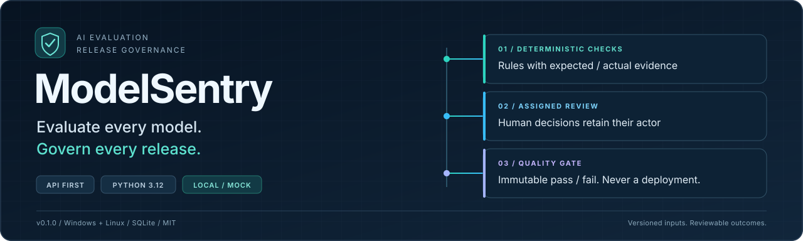
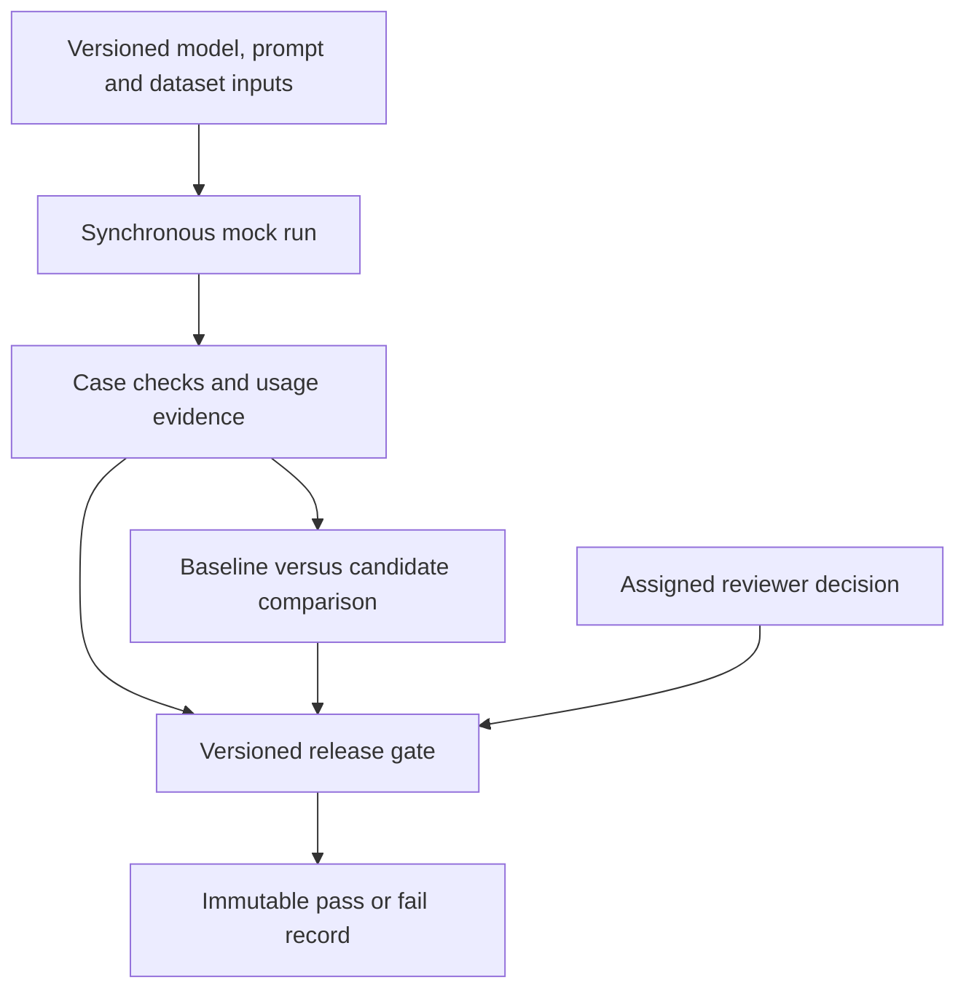

<p align="center"></p>

<p align="center">
  <a href="https://github.com/swam-loose/modelsentry/actions/workflows/ci.yml"></a>
  <a href="https://github.com/swam-loose/modelsentry/releases/tag/v0.1.0"></a>
  <a href="pyproject.toml"></a>
  <a href="LICENSE"></a>
</p>

<p align="center"><strong>Turn model and prompt changes into versioned, testable, reviewable release evidence.</strong><br>An open-source Python API connecting evaluation datasets, deterministic checks,<br>run comparisons, assigned reviewers, and release quality gates.</p>

<p align="center"><a href="#why-modelsentry">Why ModelSentry</a> · <a href="#see-the-workflow">Demo</a> · <a href="#quickstart">Quickstart</a> · <a href="#capabilities">Capabilities</a> · <a href="#architecture">Architecture</a> · <a href="#documentation">Documentation</a></p>

> [!IMPORTANT]
> **v0.1.0 is a local, single-organization release with a mock provider.**
> It makes no real LLM calls, has no graphical dashboard, and never deploys or
> promotes a model. Synthetic metrics demonstrate the workflow, not real model
> performance. [Read the release scope](docs/RELEASE_NOTES_0.1.0.md).

## Why ModelSentry

A changed prompt, a passing test, a reviewer approval, and a release decision
are different pieces of evidence. ModelSentry connects them without treating
one as a substitute for the others.

- **What changed?** Compare baseline and candidate runs against the same
  immutable dataset version, aligned case by case.
- **Why did a check fail?** Inspect the evaluator, expected value, actual value,
  and evidence instead of relying on an unexplained aggregate score.
- **Who decided?** Keep the assigned reviewer separate from the authenticated
  actor who submitted the final decision.
- **Does the candidate meet the policy?** Evaluate versioned criteria and
  preserve that decision even when later reviews or policies change.

The current release is useful for exploring evaluation architecture, testing
policy rules, and reproducing governance scenarios without paid APIs or model
hardware. It is not yet a tool for benchmarking real LLMs.

The workflow is designed around AI application developers, QA/evaluation
engineers, and release reviewers. In this release, use synthetic fixtures to
validate that workflow before adding a real provider integration.

## See the workflow

The included demo exercises the **real API, authentication, migrations,
evaluators, and governance services** with two invented support-policy cases.
The model outputs and reviewer action are explicitly simulated.

| Stage | Case results | Gate decision | What it demonstrates |
| --- | --- | --- | --- |
| Known-good baseline | 2 / 2 pass | Reference run | Establishes the comparison baseline |
| Deliberate prompt regression | 0 / 2 pass | **Failed** | Quality loss is detected and blocked |
| Restored candidate, pending review | 2 / 2 pass | **Failed** | Correct outputs do not bypass approval |
| Same candidate, assigned reviewer approves | 2 / 2 pass | **Passed** | All configured requirements are satisfied |

The demo also verifies that an unrelated reviewer receives **HTTP 403**, a
viewer cannot register a model, duplicate dataset content is rejected, final
reviews cannot be rewritten, and earlier gate decisions remain unchanged.

<details>
<summary><strong>View the key fields from a successful demo</strong></summary>

```json
{
  "mode": "synthetic_mock_demo",
  "baseline_pass_rate": 1.0,
  "regressed_pass_rate": 0.0,
  "fixed_pass_rate": 1.0,
  "regression_gate": "failed",
  "unreviewed_fixed_gate": "failed",
  "reviewed_fixed_gate": "passed",
  "unauthorized_reviewer_http": 403,
  "previous_gate_evidence_unchanged": true,
  "human_review_is_simulated": true,
  "deployment_performed": false
}
```

The failed gate decisions are safeguards being demonstrated. The test itself
must finish with `SYNTHETIC_DEMO_PASSED` and `1 passed`.

</details>

## Quickstart

**Requirements:** Python **3.12** and Git. No Docker, WSL, PostgreSQL, Redis,
GPU, or paid model account is required.

Start with the isolated demo. It creates a temporary database and random test
secrets; you do not need a `.env` file or a running server.

<details open>
<summary><strong>Windows · PowerShell</strong></summary>

For a fresh checkout:

```powershell
git clone https://github.com/swam-loose/modelsentry.git
Set-Location modelsentry
py -3.12 -m venv .venv
& ".\.venv\Scripts\python.exe" -m pip install --editable ".[dev]"
& ".\.venv\Scripts\python.exe" -m pytest tests/test_synthetic_demo.py -p "no:cacheprovider" -q -s
```

The explicit interpreter path avoids global-Python mismatches and the need
to change PowerShell script-execution policies.

</details>

<details>
<summary><strong>Linux · Bash</strong></summary>

```bash
git clone https://github.com/swam-loose/modelsentry.git
cd modelsentry
python3.12 -m venv .venv
.venv/bin/python -m pip install --editable '.[dev]'
.venv/bin/python -m pytest tests/test_synthetic_demo.py -p no:cacheprovider -q -s
```

</details>

**Already have the repository?** Keep your environment and run only the demo
command from the project root. The demo does not use your normal database or
print API keys. [Full scenario and expected evidence](docs/SYNTHETIC_DEMO.md).

### Run the interactive API

For persistent local use, follow [Getting started](docs/GETTING_STARTED.md):
configure independent secrets, apply migrations, start the loopback server,
and bootstrap the first administrator.

| Local endpoint | Purpose |
| --- | --- |
| `http://127.0.0.1:8000/docs` | Swagger UI with API-key authorization |
| `http://127.0.0.1:8000/redoc` | Read-only API reference |
| `http://127.0.0.1:8000/api/v1/health` | Public health check |

These addresses work **after you start the API locally**. There is no hosted
application or public demo server.

## Capabilities

| Area | Available in v0.1.0 | Why it matters |
| --- | --- | --- |
| Model registry | Model names, provider metadata, identifiers, and cost rates | Identify the configuration behind each run |
| Prompt versions | Immutable templates, variables, and change notes | Reproduce the exact prompt used |
| Evaluation datasets | JSON / JSONL cases, immutable versions, SHA-256 hashes, and deduplication | Compare against an unchanged test set |
| Deterministic evaluation | Exact match, substring, JSON equality, JSON Schema, required terms, and forbidden terms | Review explicit rules with per-check evidence |
| Run history | Outputs, execution errors, check results, and aggregate pass rates | Investigate more than the headline score |
| Run comparisons | Case-level quality, latency, token, and estimated-cost deltas | Distinguish regressions from improvements and trade-offs |
| Human review | Assignments, final decisions, rationale, and actor attribution | Separate automation from accountable decisions |
| Release gates | Versioned policies and immutable expected-versus-actual decisions | Preserve which criteria passed or blocked a candidate |
| Access control | Bearer API keys, four roles, expiry, and revocation | Separate operators, reviewers, viewers, and administrators |
| Verification | Alembic migrations, Windows/Linux CI, distribution checks, and synthetic demo | Reproduce installation and behavior |

### What a release gate checks

The default policy requires **100% pass rate, zero errored cases, human
approval, and no deterministic quality regression** against a baseline.
Optional limits cover average latency, p95 latency, and estimated cost.

A gate snapshots its policy version and records an ordered list of
expected-versus-actual checks. Later approvals or policy changes do not
silently rewrite earlier decisions. **A passing gate is a governance record,
not a deployment command.**

## From one case to reviewable evidence

A case declares its input and expected behavior. With the mock provider,
`input.mock_response` explicitly controls the synthetic output:

```json
{
  "case_key": "password-reset-policy",
  "input": {
    "question": "How can I reset my password?",
    "mock_response": "Use the official password reset link."
  },
  "expected_output": {
    "mode": "all",
    "evaluators": [
      {"type": "required_terms", "terms": ["reset link"]},
      {"type": "forbidden_terms", "terms": ["share your password"]}
    ]
  },
  "metadata": {"synthetic": true}
}
```

Every check exposes its evaluator type, expected value, actual evidence,
message, and pass/fail result. Rules can use `all` or `any` composition.
This fixture demonstrates rule execution, not a real model answering the
question or a guarantee of complete response safety.

Follow the [API guide](docs/API_GUIDE.md) for a complete request sequence.

## Architecture



FastAPI exposes the workflow; Pydantic defines request boundaries; services
coordinate business rules; SQLAlchemy repositories persist records in SQLite.
Provider generation and deterministic checks are separate modules. Alembic
manages the schema rather than creating tables on application startup.

| Repository area | Responsibility |
| --- | --- |
| `app/api/routes/` | HTTP resources, authentication entry points, and response mapping |
| `app/schemas/` · `app/services/` | Validated inputs and governance rules |
| `app/providers/` · `app/evaluation/` | Mock generation, template rendering, and deterministic checks |
| `app/models/` · `app/repositories/` · `app/db/` | Persistence, queries, and session lifecycle |
| `app/auth/` · `app/core/` | Credentials, roles, and configuration |
| `migrations/` · `tests/` · `scripts/` | Schema history, tests, and package verification |

### Deliberate trade-offs

| Choice | Benefit now | Boundary |
| --- | --- | --- |
| SQLite and a local application | Small, reproducible setup | Not a multi-tenant or distributed platform |
| Deterministic mock provider | No paid API or model download | No real LLM quality or billing measurements |
| Synchronous execution | Direct, traceable first workflow | No queue, scheduler, or background worker |
| Explicit rule-based checks | Reviewable evidence | No guarantee of truth, fairness, or exhaustive security |

## API surface

Paths below use `/api/v1`. Product resources require a bearer API key.

| Resource | Main operations | Guide |
| --- | --- | --- |
| `/health` | Public health check | [Start the API](docs/GETTING_STARTED.md#start-the-server) |
| `/auth` | Bootstrap, identity, users, and API keys | [Authentication](docs/API_GUIDE.md#authentication) |
| `/models` | Register, list, and inspect models | [Create the inputs](docs/API_GUIDE.md#create-the-inputs) |
| `/prompts` | Register templates and immutable versions | [Create the inputs](docs/API_GUIDE.md#create-the-inputs) |
| `/datasets` | Register datasets and JSON / JSONL versions | [Create the inputs](docs/API_GUIDE.md#create-the-inputs) |
| `/runs` | Execute a mock run and inspect evidence | [Execute a run](docs/API_GUIDE.md#execute-a-run) |
| `/run-comparisons` | Compare completed runs on one dataset version | [Comparisons](docs/API_GUIDE.md#compare-runs) |
| `/reviews` | Assign reviewers and record final decisions | [Human review](docs/API_GUIDE.md#human-review) |
| `/release-gates` | Version policies and evaluate candidates | [Release gates](docs/API_GUIDE.md#release-gates) |

## Security and responsible use

| Role | Read product data | Operate resources | Final review decisions | Manage identities |
| --- | --- | --- | --- | --- |
| `admin` | Yes | Yes | Yes, including attributed overrides | Yes |
| `operator` | Yes | Yes | No | No |
| `reviewer` | Yes | No | Own assignments only | No |
| `viewer` | Yes | No | No | No |

Raw API keys are returned only when issued. The application stores an
HMAC-SHA-256 digest and non-secret prefix. Bootstrap is one-time and atomic;
review decisions preserve the authenticated actor separately from the assigned
reviewer. Local accounts do **not** prove identity or email ownership.

Keep secrets out of Git, keep the API-key pepper stable, and use synthetic data
for public demos. This release is not an internet-ready hosted service or a
security certification. Read [SECURITY.md](SECURITY.md) before shared access.

## Verification and release evidence

The [v0.1.0 release](https://github.com/swam-loose/modelsentry/releases/tag/v0.1.0)
was published from
[`9beb263`](https://github.com/swam-loose/modelsentry/commit/9beb2631fa9ec35de8ac3d6be98c1cff2f6145d3).
The following records **that release**, not live coverage for future commits:

| Check | v0.1.0 evidence |
| --- | --- |
| Automated tests | 216 passing tests |
| Application coverage | 95.10% with branch coverage enabled; 95% required |
| Platforms | Windows and Linux, Python 3.12 |
| Migrations | Upgrade, schema-drift check, and downgrade on disposable storage |
| Distribution integrity | Metadata, version, contents, and MIT license inspected |
| Installed wheel | Smoke-tested outside the checkout in an isolated environment |
| Published assets | Wheel, source distribution, and `SHA256SUMS.txt` |

[Inspect the release CI](https://github.com/swam-loose/modelsentry/actions/runs/42508407788)
or [run the checks locally](docs/GETTING_STARTED.md#verification).
CI has read-only repository permissions and does not automatically publish or deploy.

> [!NOTE]
> The wheel contains the runtime package and license. Alembic configuration and
> migration history are in the **source distribution / checkout**. Start from
> source when setting up the database. No PyPI upload was part of this release.

## Documentation

| I want to… | Go to |
| --- | --- |
| Install, configure secrets, and start the server | [Getting started](docs/GETTING_STARTED.md) |
| Bootstrap an admin and make API requests | [API guide](docs/API_GUIDE.md) |
| Reproduce the governance scenario | [Synthetic demo](docs/SYNTHETIC_DEMO.md) |
| Understand credential and deployment boundaries | [Security policy](SECURITY.md) |
| Inspect the published scope and known limits | [Release notes](docs/RELEASE_NOTES_0.1.0.md) |
| Review history and publication checks | [Changelog](CHANGELOG.md) · [Release checklist](docs/RELEASE_CHECKLIST.md) |

## Roadmap

The local/mock release above is complete. These are **future directions, not
available integrations or delivery commitments**:

- Ollama and other real provider adapters, using provider-reported usage.
- Asynchronous execution and job lifecycle management.
- Organization isolation and external identity-provider integration.
- A graphical dashboard and richer reporting workflows.

## Contributing

Use Python 3.12, install `.[dev]`, keep examples synthetic, and run Ruff,
formatting checks, and tests before a pull request. Keep automated results,
human decisions, and release evidence separate; do not treat mock metrics as
real model benchmarks or add implicit deployments.

For ordinary features, branch from `develop` and target `develop`. Never
commit a real `.env`, API key, runtime database, or personal dataset. For
security-sensitive findings, follow [the reporting policy](SECURITY.md#reporting)
instead of posting secrets or sensitive details in a public issue.

## License

[MIT](LICENSE) · Copyright (c) 2026 Wilian Ataide.
The license is included in both published distributions.

<p align="center"><sub>Versioned inputs. Reviewable evidence. Accountable decisions.</sub></p>
